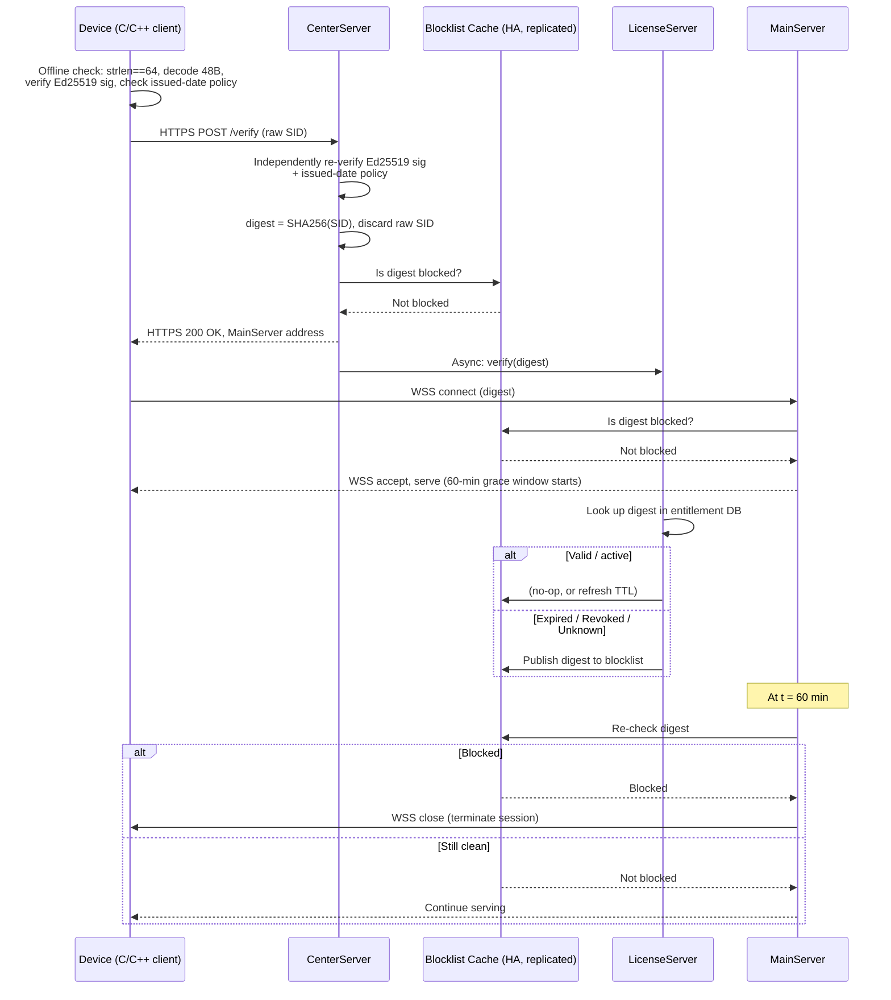
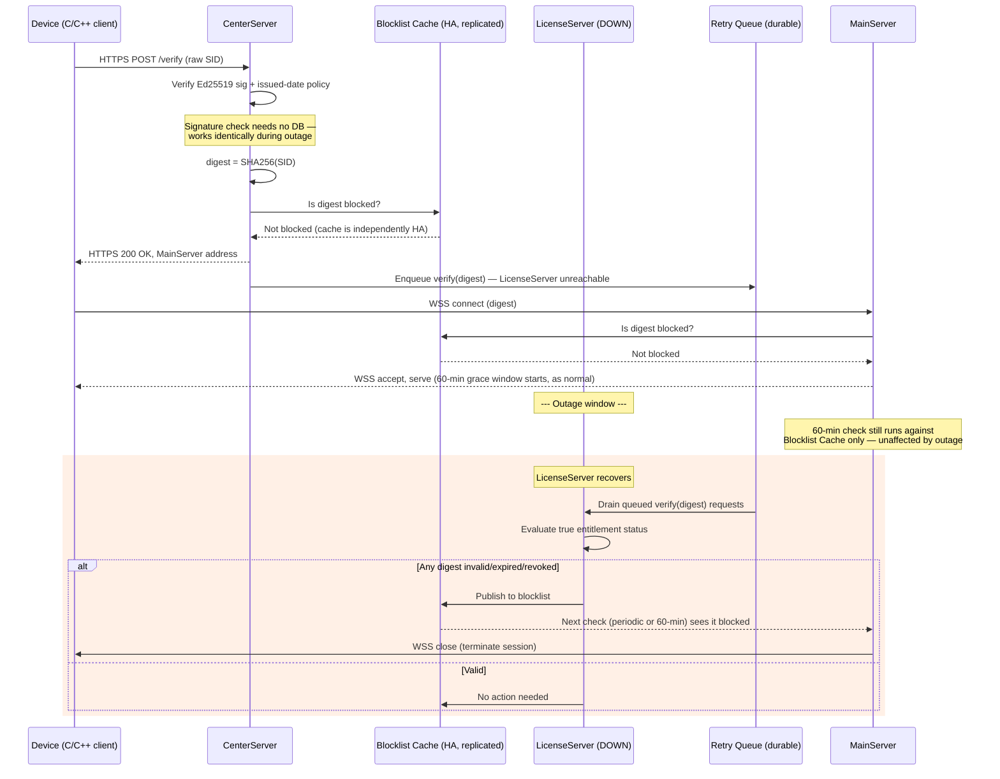

# SID Licensing Protocol — Architecture Design Document (v2)

Status: **For Review**
Supersedes: `sid_licensing_architecture.md` (v1)
Change driver: fail-open-on-availability / fail-closed-on-integrity requirement for LicenseServer outages.

---

## 1. Design Goals & Constraints

- SID is exactly **64 ASCII characters**, Base64URL-encoded, decoding to a **48-byte** raw binary payload (zero padding).
- Payload carries a full, untruncated **Ed25519** signature (32 bytes) — offline-verifiable using an embedded public key, no network required.
- **Offline check** (device + CenterServer): proves a SID was legitimately issued. Never depends on any database.
- **Online check** (LicenseServer): proves a SID is *currently* active (not expired/refunded/revoked). Depends on a database, and databases can go down.
- **Service decoupling:** routing (CenterServer), entitlement truth (LicenseServer), and product logic (MainServer) are independent services with independent failure domains.
- **Zero-knowledge downstream:** past the point of signature verification, only `SHA-256(SID)` ("digest") is ever stored, logged, or transmitted — never the raw SID.
- **60-minute grace window:** a SID that passes offline verification gets immediate access; background/async validation catches anything wrong within that window and kicks it globally.
- **Availability requirement (new in v2):** if LicenseServer is down, cryptographically legitimate SIDs must **still** be allowed in (fail-open). Once LicenseServer recovers, any SID that should have been rejected during the outage gets caught and blocked globally (fail-closed catch-up). This must hold **without weakening any of the properties above**.
- **Issued-SID database:** the organization maintains a full record of every SID ever released (for audits, support, business reporting). This store is **out of the runtime trust/verification path** — nothing in the access-decision flow reads from or depends on it. It is bookkeeping, not an authority.

---

## 2. SID Binary Format (unchanged from v1)

```
0                   1                   2                   3
0 1 2 3 4 5 6 7 8 9 0 1 2 3 4 5 6 7 8 9 0 1 2 3 4 5 6 7 8 9 0 1
+-+-+-+-+-+-+-+-+-+-+-+-+-+-+-+-+-+-+-+-+-+-+-+-+-+-+-+-+-+-+-+-+
|                   Issued Timestamp (4 Bytes)                   |
+-+-+-+-+-+-+-+-+-+-+-+-+-+-+-+-+-+-+-+-+-+-+-+-+-+-+-+-+-+-+-+-+
|   Flags / License Type (2B)   |   Entropy / Device Nonce...   |
+-+-+-+-+-+-+-+-+-+-+-+-+-+-+-+-+-+-+-+-+-+-+-+-+-+-+-+-+-+-+-+-+
|                       ... Entropy (10 Bytes Total)            |
+-+-+-+-+-+-+-+-+-+-+-+-+-+-+-+-+-+-+-+-+-+-+-+-+-+-+-+-+-+-+-+-+
|                    Full Ed25519 Signature (32 Bytes)           |
+-+-+-+-+-+-+-+-+-+-+-+-+-+-+-+-+-+-+-+-+-+-+-+-+-+-+-+-+-+-+-+-+
```

- **Payload (16 bytes):** Issued Timestamp (4B) + Flags/License Type (2B) + Entropy/Nonce (10B).
- **Signature (32 bytes):** `Ed25519.Sign(PrivateKey, Payload)`.
- `SID = Base64URL( Payload(16B) || Signature(32B) )` → exactly 64 characters.
- No expiry field is embedded — expiry is intentionally an online-only fact, not a signable constant.

---

## 3. Components & Trust Boundaries

| Component | Sees raw SID? | Sees digest? | Depends on DB? | Can go down without blocking legit users? |
|---|---|---|---|---|
| **Device / C++ client** | Yes (has it) | Computes it | No | N/A |
| **CenterServer** | Yes, transiently (verify + hash, never stored) | Yes | Only reads Blocklist Cache (HA) | Must itself be HA — it's the gatekeeper |
| **Blocklist Cache** | No | Yes | It *is* the cache (replicated) | Must be HA |
| **LicenseServer** | No | Yes | Yes — entitlement DB (system of record for status) | **Yes — this is the point of v2** |
| **MainServer** | No | Yes | Only reads Blocklist Cache (HA) | Must be HA |
| **Issued-SID DB** | Yes (at issuance time only) | — | N/A (it's the record store) | Yes — fully out of runtime path |

Key v2 change: **CenterServer performs its own Ed25519 verification** using the raw SID (sent over TLS from the device), rather than trusting the client's local check or a LicenseServer DB lookup. This is what makes fail-open safe — signature validity is math, not state, so it can never be "stale" and never depends on anything that can be unavailable.

**Transport protocols (v2):**
- **Device → CenterServer:** `HTTPS` request/response (single round trip per SID check — device sends the SID, gets back an admission decision + MainServer address, or a rejection).
- **Device → MainServer:** `WSS` (WebSocket over TLS) — persistent connection for the duration of the session, which is what allows MainServer to push a server-initiated disconnect the moment the 60-minute (or periodic) blocklist check fails, rather than waiting for the client to poll or reconnect.

---

## 4. Sequence Diagram — Normal Path (LicenseServer healthy)



---

## 5. Sequence Diagram — LicenseServer Outage (fail-open, then catch-up)



**What this achieves:** during the outage, access decisions rest entirely on (a) cryptographic proof of legitimate issuance, done independently by CenterServer, and (b) the Blocklist Cache, which is a separate HA tier and does not share LicenseServer's failure domain. Nothing that was already known-bad before the outage gets back in. Anything that becomes invalid *during* the outage is caught as soon as the retry queue drains after recovery — bounded by outage duration plus one drain cycle.

---

## 6. Component Responsibilities (Detailed)

### 6.1 Device (C/C++ client)
- Enforces `strlen(SID) == 64` before touching it.
- Decodes to a fixed 48-byte stack buffer (no heap allocation).
- Performs local Ed25519 verification + issued-date-not-before-X policy check as a first-pass UX gate (fail fast, no network round trip for obviously bad input).
- This local check is **advisory only** — never trusted as the security boundary, since it runs on hardware the user controls.
- Sends the raw SID to CenterServer as an `HTTPS` request for the authoritative check, and reads the admission decision + MainServer address from the response.
- Opens a `WSS` (WebSocket-over-TLS) connection to the returned MainServer address to actually use the service. WSS is chosen over plain HTTPS here because the session is long-lived and MainServer needs to be able to push a disconnect to the client at any time (e.g. at the 60-minute check), not just respond to client-initiated requests.

### 6.2 CenterServer
- Exposes an `HTTPS` endpoint the device calls with the raw SID; the response is a single request/response cycle (admission decision + MainServer address, or a rejection code) — no persistent connection needed here, unlike the MainServer leg.
- **Independently** re-verifies the Ed25519 signature and issued-date policy — does not trust the device's result.
- Computes `digest = SHA256(SID)` immediately; the raw SID is never persisted, logged, or forwarded past this point.
- Checks the Blocklist Cache (not LicenseServer directly) for the digest.
- If clean → returns a MainServer address to the device, and fires an **async** `verify(digest)` event to LicenseServer (fire-and-forget with durable retry queue on failure).
- If LicenseServer is unreachable, the verify event goes into a durable retry queue rather than blocking the allow decision.

### 6.3 Blocklist Cache
- Replicated, independently-available key-value store (e.g. Redis Cluster) keyed by digest.
- Written to only by LicenseServer (publishing revocations/expirations).
- Read by CenterServer and MainServer directly — neither ever queries LicenseServer's DB live in the request path.
- This is the component whose uptime everything else's fail-open behavior depends on — it should be held to a higher SLA than LicenseServer itself.

### 6.4 LicenseServer
- System of record for entitlement status (active / expired / revoked) per digest.
- Consumes the async verify-request stream (direct + drained retry queue after any outage).
- Publishes changes to the Blocklist Cache; does not serve read requests in the hot path of access decisions.
- Can be unavailable without blocking new legitimate sessions — its only failure mode is delayed *detection* of newly-invalid SIDs, not incorrect admission of provably-forged ones.

### 6.5 MainServer
- Accepts the device's connection as a `WSS` (WebSocket-over-TLS) session — persistent for the lifetime of use, and the channel through which a server-initiated kick (session termination) is delivered instantly at the 60-minute check or on a later blocklist hit.
- Trusts CenterServer's initial admission decision.
- Reads the Blocklist Cache directly (not through CenterServer or LicenseServer) both at connection time and again at the 60-minute mark.
- Terminates any active session whose digest appears in the Blocklist Cache.

### 6.6 Issued-SID Database
- Out of the runtime verification/decision path entirely, as confirmed.
- Populated at issuance time by the Issuing Authority (private-key holder).
- Used for audit, support lookups, reporting, and key-rotation bookkeeping — not consulted by CenterServer, LicenseServer, or MainServer during normal operation.

---

## 7. CenterServer Decision Logic (Pseudocode)

```text
on receive(raw_sid) from device over TLS:
    if len(raw_sid) != 64: reject(MALFORMED); exit

    payload, signature = base64url_decode(raw_sid)   # 16B, 32B
    if not ed25519_verify(payload, signature, EMBEDDED_PUBLIC_KEY):
        reject(INVALID_SIGNATURE); exit

    if payload.issued_timestamp < MIN_ACCEPTED_ISSUED_DATE:
        reject(REVOKED_KEY_EPOCH); exit

    digest = sha256(raw_sid)
    raw_sid = null   # discard; never persisted or logged past this point

    if blocklist_cache.contains(digest):
        reject(BLOCKED); exit

    # Admission granted — independent of LicenseServer availability
    respond(OK, main_server_address)

    # Best-effort, non-blocking
    try:
        license_server.async_verify(digest)
    except Unreachable:
        retry_queue.enqueue(digest)
```

## 8. MainServer 60-Minute Check (Pseudocode)

```text
on connection(digest):
    if blocklist_cache.contains(digest):
        deny(); exit
    serve()
    schedule_check(digest, delay = 60min)

on scheduled_check(digest):
    if blocklist_cache.contains(digest):
        terminate_session(digest)
    else:
        schedule_check(digest, delay = 60min)   # keep re-checking periodically
```

---

## 9. Security Properties Preserved / Achieved in v2

| Property | Mechanism |
|---|---|
| Offline authenticity, unforgeable without private key | Ed25519 signature, verified independently by both device and CenterServer |
| No default-allow of unregistered/forged SIDs | CenterServer performs real signature verification itself, not just a blocklist absence check |
| Zero-knowledge downstream of CenterServer | Raw SID touched only transiently by CenterServer; digest-only from that point on |
| Service decoupling maintained | MainServer and CenterServer never call LicenseServer's DB directly — only the replicated Blocklist Cache |
| Global kick on invalidation | Blocklist Cache is read by every MainServer/CenterServer instance, everywhere |
| **Fail-open on LicenseServer outage** | Admission depends only on crypto + Blocklist Cache, neither of which shares LicenseServer's failure domain |
| **Fail-closed catch-up after recovery** | Durable retry queue drains on recovery; any newly-invalid digest is published to Blocklist Cache and enforced at the next 60-min (or periodic) check |
| Issued-SID DB stays out of trust path | Confirmed: used for audit/bookkeeping only, never queried during access decisions |

## 10. Accepted Trade-off (explicit sign-off needed)

A SID that becomes invalid (revoked/refunded/banned) **for the first time during a LicenseServer outage** will continue to work until the retry queue drains after recovery. This window is bounded by outage duration + one drain cycle, and only affects revocations *originating* during the outage — it does not affect any SID already known-bad beforehand, and it does not allow any SID that fails the Ed25519 check. This is the intended behavior per the availability requirement; flag here if the exposure window needs an additional bound (e.g. a hard cap independent of outage length).

---

## 11. Open Items for Review

- [ ] Confirm TLS/mTLS is mandatory on all hops: device↔CenterServer (`HTTPS`), device↔MainServer (`WSS`), CenterServer↔LicenseServer, CenterServer/MainServer↔Blocklist Cache.
- [ ] Decide WSS reconnect/backoff policy for the device (e.g. transient network drop mid-session) — should a reconnect require a fresh CenterServer round trip, or can MainServer accept a reconnect with the same digest within a short window without re-admission?
- [ ] Confirm Blocklist Cache SLA target (should exceed LicenseServer's, since everything's fail-open behavior depends on it).
- [ ] Decide concurrent-session policy per digest (single-session enforcement vs. allowed sharing) — not yet addressed by this design.
- [ ] Decide retry-queue durability guarantees (at-least-once redelivery, dedup on digest, max backlog age).
- [ ] Confirm error codes returned to device stay generic (don't leak malformed vs. unknown vs. revoked distinctions).
- [ ] Confirm `MIN_ACCEPTED_ISSUED_DATE` is a hardcoded per-build constant, not derived from device clock.
- [ ] Confirm Redis deployment mode (Cluster vs. managed HA service) and AOF persistence are both enabled before go-live — without persistence, a Redis restart silently reopens every previously-revoked SID.
- [ ] Decide whitelist-cache TTL relative to LicenseServer's own re-verification cadence, so a stale whitelist entry can't outlive a revocation for longer than intended.
- [ ] Confirm MainServer's in-memory `liveConns` map strategy (sharding scheme, eviction on disconnect) is sized for target concurrent-connection count.

---

## 12. Transport Choice: HTTPS/WSS vs. Raw TLS Socket

Note: HTTPS and WSS are already built on TLS — the real alternative under consideration is dropping HTTP/WebSocket framing in favor of a custom binary protocol directly over a TLS socket.

| | HTTPS / WSS (current design) | Raw TLS socket + custom protocol |
|---|---|---|
| **Pros** | Standard L7 load balancers, API gateways, WAFs, CDNs understand it natively (path routing, rate limiting, DDoS protection) | Lower per-message overhead — no HTTP headers, no WS frame overhead |
| | Debuggable with curl / browser devtools / standard APM & tracing tools | Full control over binary framing — can match the fixed 48-byte SID structures exactly, no base64/JSON tax |
| | Mature client libraries (libcurl, WS libs) — less custom-parser attack surface, which matters given the client is C/C++ | Firewall-agnostic on any chosen port |
| | WSS is the only way a browser-based client (future dashboard/admin tool) gets a persistent socket | No forced HTTP semantics (status codes, verbs) if the protocol isn't genuinely request/response-shaped |
| | Blends in on restrictive corporate networks that only allow HTTP(S)-looking traffic on 443; some DPI/proxies flag or throttle non-HTTP TLS on 443 | |
| **Cons** | Small per-message framing overhead (HTTP headers, WS frames) — usually negligible at this scale | Loses L7 infra entirely — falls back to plain L4/TCP load balancing: no path routing, no built-in rate limiting/WAF, health checks reduce to "is the port open" |
| | | Custom protocol = custom bugs — hand-rolled message framing/parsing in C/C++ on the client is exactly the surface that produces buffer-overflow/parsing CVEs |
| | | No standard tooling — debugging/observability must be built in-house |
| | | Forecloses any browser-based client permanently |

**Recommendation:** keep HTTPS (CenterServer) and WSS (MainServer). For CenterServer's single request/response pattern, HTTPS overhead is negligible and the tooling/infra benefits are large. For MainServer, WSS already provides the persistent, server-push-capable channel the 60-minute kick needs. Only reconsider raw TLS if a measured, specific latency ceiling is provably caused by HTTP/WS framing — a narrow case, and the usual fix there is a leaner binary payload *inside* WSS rather than abandoning WSS.

---

## 13. MainServer Implementation: Go

Go is a strong fit for MainServer specifically, given its job is holding a large number of persistent, low-activity connections and reacting to external events (revocations, 60-minute timers).

- **Concurrency:** goroutines make holding tens of thousands of concurrent WSS connections cheap — one goroutine per connection is a normal, idiomatic pattern at this scale.
- **WebSocket library:** `nhooyr.io/websocket` (a.k.a. `coder/websocket`) — modern, context-aware, smaller API surface. `gorilla/websocket` is the older, still-stable alternative with a larger existing ecosystem if that matters for hiring/familiarity.
- **Redis client:** `redis/go-redis` — mature, supports Cluster mode and pub/sub.
- **Timers:** `context.WithDeadline` / `time.AfterFunc` map directly onto "schedule the 60-minute check per connection."

**Concrete upgrade this enables:** rather than MainServer only *polling* the Blocklist Cache at the 60-minute mark, have it **subscribe to a Redis pub/sub channel** (e.g. `blocklist-events`) that LicenseServer publishes to on every revocation, and keep an in-memory `map[digest]*websocket.Conn` (sharded, or `sync.Map`) of currently-live sessions. A revocation then triggers an **immediate** `WSS close` on any matching live connection, rather than waiting for the next scheduled check. This tightens the "kicked from anywhere" guarantee from "within 60 minutes" to "within seconds," at low implementation cost in Go.

```text
# MainServer (Go), pseudocode

var liveConns = NewShardedMap[digest, *websocket.Conn]()

func onConnect(digest string, conn *websocket.Conn):
    if blocklistCache.Contains(digest):
        conn.Close(reason: "blocked")
        return
    liveConns.Store(digest, conn)
    scheduleCheck(digest, delay: 60*time.Minute)

func onScheduledCheck(digest string):
    if blocklistCache.Contains(digest):
        kick(digest)
    else:
        scheduleCheck(digest, delay: 60*time.Minute)

func onBlocklistEvent(digest string):   # from Redis pub/sub subscriber goroutine
    kick(digest)

func kick(digest string):
    if conn, ok := liveConns.Load(digest); ok:
        conn.Close(reason: "revoked")
        liveConns.Delete(digest)
```

Main scaling caveat: watch GC pressure past ~100k+ concurrent connections — pre-allocate read/write buffers per connection and avoid per-message heap allocations on the hot path.

---

## 14. Blocklist Cache (Redis) & Optional Whitelist Cache

### 14.1 Redis recommendations

- Run as managed HA (ElastiCache, Memorystore, Redis Enterprise) or self-run Redis Cluster with replicas and automatic failover. This cache's uptime is now what the fail-open guarantee depends on — its SLA target should exceed LicenseServer's, not trail it.
- Enable **AOF persistence**. Without it, a Redis restart silently forgets every revocation, meaning previously-blocked SIDs would work again until LicenseServer fully re-syncs — a real security regression, not just a performance blip.
- Key shape: `blocklist:{digest}` → `{reason, timestamp}`. Use a TTL only for temporary suspensions; permanent revocations should have no TTL.
- Use an explicit pub/sub channel (`blocklist-events`) that LicenseServer publishes to, rather than Redis keyspace notifications — simpler to reason about and avoids cluster-wide keyspace-notification overhead.

### 14.2 Should a Whitelist Cache be added?

Two separate motivations worth distinguishing:

- **As a security fix — not needed.** That gap was already closed when CenterServer began independently verifying the Ed25519 signature itself. The signature check *is* the whitelist, computed rather than looked up, and it holds even when every cache/DB is down.
- **As a performance optimization — yes, worthwhile.** Currently every admitted connection triggers an async `verify(digest)` call to LicenseServer, even for a device that reconnects daily. A `whitelist:{digest}` entry (confirmed-active, short TTL matching the check cadence) lets CenterServer skip the LicenseServer round-trip entirely on a cache hit, meaningfully reducing LicenseServer load for repeat traffic.

**Three-state cache logic:**

```text
on CenterServer admission check(digest):
    if blocklist_cache.contains(digest):
        reject(BLOCKED); exit

    if whitelist_cache.contains(digest):
        admit()  # skip LicenseServer round trip entirely
        return

    # unknown — fail-safe path, same as today
    admit()  # signature already verified independently by CenterServer
    license_server.async_verify(digest)  # result populates whitelist or blocklist

on LicenseServer verify_result(digest, status):
    if status == active:
        whitelist_cache.set(digest, ttl = CHECK_INTERVAL)
        blocklist_cache.delete(digest)  # in case of a prior stale block
    else:
        blocklist_cache.set(digest, reason = status)  # no TTL if permanent
        whitelist_cache.delete(digest)
```

**Trade-off:** this adds a third cache state to reason about (`blocked` / `whitelisted` / `unknown`) and a second write on every status change (evict from whitelist *and* add to blocklist on revocation, or the reverse on reinstatement). A partial write during that two-step update degrades to `unknown`, which falls through to the signature-only admission path above — i.e. it fails safe, not open further, so the added complexity doesn't weaken any existing guarantee. Recommendation: add it, but treat it explicitly as a caching/load-reduction layer — LicenseServer's DB remains the actual source of truth either way.
